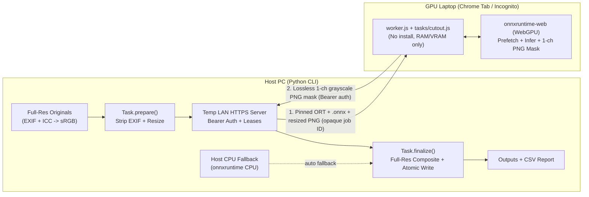

# tabgpu

Borrow a faster laptop's GPU on your trusted LAN using **nothing but a Chrome tab (WebGPU)** — zero installation and no app-managed persistence on the GPU machine, with automatic host CPU fallback if the tab isn't opened or disconnects. In v0.1, `tabgpu` runs batch AI image background removal (`tabgpu cutout`) while keeping full-resolution originals, EXIF handling, ICC color management, and atomic output writes strictly on your host PC.

> _Demo placeholder: terminal + Chrome Incognito GPU worker side-by-side recording coming in v0.1 release._

---

## 30-Second Quickstart

1. **Install on your host PC** (Python 3.11+):
   ```bash
   pip install tabgpu
   # or run directly with pipx / uvx:
   # uvx tabgpu doctor
   ```

2. **Start a batch cutout job on the host PC:**
   ```bash
   tabgpu cutout ./photos/*.jpg -o ./cutouts --bg transparent --model balanced
   ```
   `tabgpu` binds a temporary local HTTPS server on your LAN IP and prints a short pairing URL (e.g., `https://192.168.1.23:8787/#<token>`) plus the certificate's SHA-256 fingerprint.

3. **Open that URL in Chrome (Incognito recommended) on your GPU laptop:**
   Accept the one-time self-signed certificate warning, verify the detected GPU adapter name, and click **Start GPU Worker**. When the batch completes (or you click **Stop**), the tab releases all WebGPU buffers and displays **"Released — safe to close tab"**. If you skip this step, `--mode auto` waits `--wait-seconds` and finishes the batch on your host CPU automatically.

---

## Architecture



### CLI Commands & Options

```bash
# Check LAN interfaces, port availability, local onnxruntime, and OS firewall hints
tabgpu doctor

# Batch background removal
tabgpu cutout ./input_dir -o ./out_dir \
  --model balanced \       # fast (u2netp 320px) | balanced (isnet 1024px) | best (birefnet-lite 1024px)
  --mode auto \            # auto (LAN then CPU fallback) | lan | cpu
  --bg transparent \       # transparent | white | #RRGGBB
  --format auto \          # auto | png | jpg | webp
  --feather 0 \            # optional mask feather radius in pixels
  --wait-seconds 60 \      # seconds to wait for a LAN worker in auto/lan mode
  --bench                  # print cold-start vs warm p50/p95 timing breakdown
```

---

## Benchmarks

Run `tabgpu cutout ... --bench` to report **cold-start** overhead separately from **warm** steady-state throughput:

| Phase / Metric | What is measured | Example Target (populate on hardware) |
| :--- | :--- | :--- |
| **Cold start — Model transfer** | LAN HTTPS fetch of `.onnx` into browser RAM | _e.g. ~170 MB over 1 Gbps LAN ≈ 1.5–3.0 s_ |
| **Cold start — WebGPU compile** | `ort.InferenceSession.create()` shader/graph compile | _Hardware & driver dependent_ |
| **Warm per-image inference** | Worker-measured `session.run()` duration (ms) | _p50 / p95 printed by `--bench`_ |
| **Warm per-image round-trip** | Host lease → fetch → WebGPU infer → 1-ch PNG upload → composite | _p50 / p95 printed by `--bench`_ |

> **Benchmark reporting template (fill in with your real run):**
> - **Host PC:** _(CPU, RAM, OS, Python version, `onnxruntime` version)_
> - **GPU Laptop:** _(Discrete GPU model, OS, Chrome version, `onnxruntime-web` `1.31.1`)_
> - **Network:** _(Wi-Fi 6 / 1 GbE LAN)_
> - **Model:** `balanced` (`isnet-general-use.onnx`, 1024×1024) or `fast` (`u2netp.onnx`, 320×320)

---

## Honest Privacy & Security

`tabgpu` is designed for **no install, nothing written by the app, and model/job buffers held in memory only** on the GPU laptop. It does **not** claim "zero trace", because browsers and operating systems have their own low-level subsystems outside any web page's control.

### What `tabgpu` enforces
- **Trusted LAN binding:** Binds to the chosen LAN interface by default (not `0.0.0.0` unless explicitly requested with `--bind 0.0.0.0`).
- **Local HTTPS with exact SANs:** Auto-generates a self-signed certificate with matching IP/DNS Subject Alternative Names (or accepts your own `--cert`/`--key`) so Chrome enables `navigator.gpu` WebGPU.
- **Fragment-only pairing token:** The per-run secret token is passed only in `#<token>`, cleared immediately via `history.replaceState`, and sent strictly in `Authorization: Bearer <token>` headers (never in query strings).
- **Request hardening:** Validates `Host` and same-origin `Origin`, rate-limits invalid auth attempts, bounds request sizes and socket timeouts, and validates uploaded mask PNG format + exact dimensions before decoding.
- **Data minimization:** The worker receives only opaque job IDs and EXIF-stripped, pre-resized pixel buffers — never original filenames, directory paths, EXIF metadata, or full-resolution originals.
- **No app-managed persistence:** All HTTP responses send `Cache-Control: no-store, no-cache, must-revalidate, max-age=0`, `Pragma: no-cache`, `Cross-Origin-Opener-Policy: same-origin`, and `Cross-Origin-Embedder-Policy: require-corp`. `/api/disconnect` also sends `Clear-Site-Data: "cache", "storage"`. The web worker never uses `IndexedDB`, `localStorage`, `sessionStorage`, `CacheStorage`, cookies, or file downloads.
- **Pinned integrity:** All `.onnx` models and `onnxruntime-web` assets are verified against pinned SHA-256 checksums on download (`.part` → verify → atomic rename) and on cache reuse.

### What the browser or OS may still touch (even with `no-store`)

| Surface | Why it happens | Mitigation |
| :--- | :--- | :--- |
| **TLS certificate exception** | Accepting a self-signed warning in a regular Chrome profile saves a temporary exception in that profile. | Use **Chrome Incognito** (recommended) or supply a LAN CA-trusted `--cert`/`--key`. |
| **Browser history & autocomplete** | Regular profiles record visited host URLs (the `#<token>` fragment is stripped on load, but the host/port remains). | Use **Chrome Incognito**. |
| **GPU / Dawn shader cache** | Chrome and GPU drivers cache compiled WebGPU/WGSL shaders on disk for performance. | OS/driver behavior; contains compiled shaders, not your image data. |
| **OS pagefile / swap / crash dumps** | Under memory pressure or a browser crash, the OS may page RAM to disk or write a crash minidump. | Standard OS behavior; click **Stop** to release tensors/sessions promptly. |
| **Trusted-LAN assumption** | Self-signed TLS protects against passive eavesdropping, but first-use acceptance assumes a trusted local network. | Verify the printed SHA-256 cert fingerprint; **never** expose `tabgpu` to the public internet. |

---

## Non-Goals & Limitations (v0.1)

- **No WAN / internet exposure**, NAT traversal, tunneling, or WebRTC.
- **No user accounts**, multi-host clusters, multi-worker concurrency, or simultaneous hybrid CPU+GPU scheduling (v0.1 uses one active LAN worker at a time, with host CPU fallback).
- **No host web dashboard**, Docker wrapper, Electron app, model zoo, or model training.
- **No worker-side model caching** (`IndexedDB`, `localStorage`, `CacheStorage`, cookies, or downloads) — each fresh tab fetches the model over the LAN into RAM/VRAM.
- **Background tab throttling:** Chrome throttles WebGPU in minimized or background tabs; keep the worker tab visible while running.
- **Windows multi-GPU laptops:** Windows may assign Chrome to the integrated GPU by default; if the worker banner flags an integrated GPU, set Chrome to **High performance** under `Windows Settings → System → Display → Graphics`.

---

## Roadmap

- **v0.1 (current):** Batch background removal (`tabgpu cutout`), `tabgpu doctor`, verified `fast` / `balanced` / `best` ONNX models, clean `Task` protocol seam (`src/tabgpu/tasks/` + `src/tabgpu/web/tasks/`).
- **v0.2 (planned):** Image upscaling (`tabgpu upscale`) adding one Python task module and one browser JS task module over the existing opaque-payload worker protocol.

---

## License

MIT License — see [LICENSE](LICENSE). Third-party runtime and model notices are documented in [THIRD_PARTY_NOTICES.md](THIRD_PARTY_NOTICES.md).
